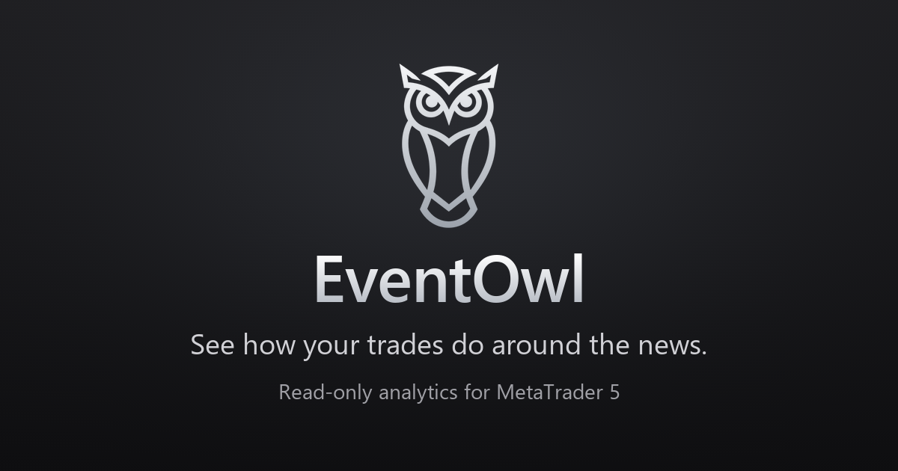

# EventOwl

**Your MT5 trades, broken down by economic event, session and fix window.**

Shows the R multiple, MAE and MFE of every closed trade and the major economic event and fix window near it, breaks your results down by session, symbol and direction, and says in plain words what stands out. A read-only panel. It never opens, changes or closes orders.

Documentation: https://lapdawgg.github.io/eventrlens/

- [Formulas](https://lapdawgg.github.io/eventrlens/formulas.html): every number and how it is calculated
- [Verify in 5 minutes](https://lapdawgg.github.io/eventrlens/verify.html): check that it only reads your account
- [Guides](https://lapdawgg.github.io/eventrlens/guides.html): MAE and MFE, economic calendar tags and the R multiple in MQL5

This repository holds only the built documentation site of EventOwl and EventOwl Pro 1.00 for MetaTrader 5. The product source code is not here.

Last updated 2026-11-22.
